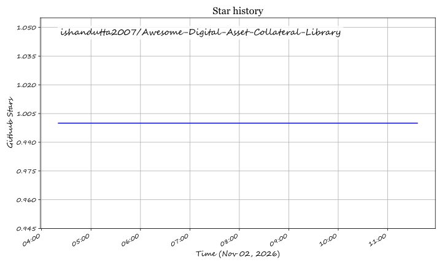

# Awesome Digital Asset & Collateral Library 📂✨

  

  
  
  
  
  
  
  

---

> **A curated showcase of premier Digital Asset Management (DAM) platforms, open-source brand collateral repositories, brand governance portals, and sales enablement engines.** 🌟 Star if you find it valuable! 🌟

**Last updated:** November 2026 🗓️

This comprehensive guide tracks leading **SaaS software platforms** and **open-source GitHub projects** designed for **Digital Asset & Collateral Libraries** (Digital Asset Management / DAM, Brand Guidelines Portals, Sales Content Management & Headless Asset Repositories). Whether you require enterprise workflow orchestration with AI auto-tagging and deal attribution or completely sovereign, self-hosted DAM architectures for human and AI-agent automation, this collection covers the full spectrum.

---

## 📑 Table of Contents

- [📈 Sector Overview & Market Dynamics](#-sector-overview--market-dynamics)
- [☁️ SaaS/Hosted Platforms](#️-saashosted-platforms)
- [💻 Open-Source GitHub Projects](#-open-source-github-projects)
- [🤝 How to Contribute](#-how-to-contribute)
- [💖 Support](#-support)
- [⭐ Star History](#--star-history)
- [⚠️ Disclaimer](#️-disclaimer)

---

## 📈 Sector Overview & Market Dynamics

The global Digital Asset Management (DAM) market is estimated at **$5.6B – $6.5B in 2025–2026** and projected to reach **$15B–$19B+ by the early 2030s** at a compound annual growth rate (CAGR) of ~14%–16%.
The sector is **moderately to highly fragmented** rather than winner-take-all, characterized by enterprise Customer Experience/CMS suites (Adobe, OpenText), dedicated mid-market brand DAM platforms (Bynder, Canto), and sales enablement content players (Highspot, Seismic) actively competing through AI metadata automation, headless architecture, and niche consolidation.

---

## ☁️ SaaS/Hosted Platforms

| Platform 🚀 | Scale (Valuation / Revenue) 🏢 | Starting Price 💵 | Free Tier / Trial Limits 🎁 | Best For / Focus 🎯 |
| :--- | :--- | :--- | :--- | :--- |
| **HubSpot Content Library** | **$13.9B Market Cap** ($2.3B+ ARR) | Free forever ($0); paid tiers start at **$15/user/month** (Starter) | **Free forever plan** (includes up to 20 MB file uploads & basic CRM files); **14-day free trial** for Professional/Enterprise tiers | HubSpot CRM users wanting native collateral management directly in CRM records |
| **Highspot** | **$3.5B Valuation** (~$213M–$450M ARR) | Custom enterprise quote; entry plans start around **$50/user/month** (~$60,000/yr typical contract) | **No automated public trial**; 30-day proof-of-concept (POC) sandbox granted through sales-led demo | Enterprise revenue and sales teams wanting sales collateral analytics and deal attribution |
| **Seismic** | **$3.0B Valuation** (~$400M ARR) | Custom enterprise quote; entry deployments start around **$65/user/month** (~$32,000/yr typical contract) | **No public free plan**; 14- to 30-day piloted sandbox trial arranged upon sales consultation | Large enterprises needing governed sales enablement content automation and buyer engagement |
| **Showpad** | **$1.0B Valuation** (~$145M ARR) | Custom quote; entry packages start around **$35/user/month** (billed annually) | **No self-serve free trial**; 14-day customized trial/POC available upon request with sales team | B2B sales teams wanting sales collateral sharing and buyer coaching in a unified eOS |
| **Bynder** | **$1.1B Valuation** ($100M+ ARR) | Custom quote; smaller team packages start around **$450/month** (~$5,400/yr) | **No public self-serve trial**; guided sandbox POC (typically 7–14 days) available via sales request | Global brands and enterprises needing governed brand portals, digital asset workflows, and rights control |
| **Brandfolder** (Smartsheet) | **$155M Acquisition** (~$70M+ ARR est.) | Custom quote; starting packages start around **$500/month** (~$6,000/yr) | **No public self-serve trial**; 14-day guided test sandbox provided upon sales evaluation | Marketing & creative teams needing visual-first brand asset management and curated brand portals |
| **MediaValet** | **$80M Acquisition** (~$16M ARR) | Custom quote; entry storage-based tiers start at **$3,600/year** ($300/month) | **No automated public trial**; free guided sandbox trial environment available upon sales consultation | Cloud-native DAM buyers wanting unlimited user seats with storage/render-based pricing |
| **Canto** | **~$50M ARR** (Private Equity backed) | Custom quote; base team deployments start around **$25,000/year** (~$2,083/month) | **7-day free trial** available via sales request form; full features during trial | Mid-market marketing teams seeking AI-assisted asset tagging, brand portals, and media workflows |
| **Paperflite** | **~$3M–$5M ARR** (Seed-backed) | **$30/user/month** (Starter / "I Got Wings" tier, min. 5 users) | **14-day free trial** (full access to content hubs, analytics, and tracking; no credit card required) | SMB and growth teams needing fast sales collateral distribution with document tracking |
| **ClearSlide** (Bigtincan) | **Subsidiary of Bigtincan** (~$60M Bigtincan ARR) | Custom quote; entry tiers start at **$35/user/month** (billed annually) | **No automated public free trial**; custom demo and evaluation sandbox via sales contact | Sales teams prioritizing live presentation engagement, buyer screen tracking, and collateral follow-ups |

---

## 💻 Open-Source GitHub Projects

| Project 🛠️ | GitHub_Stars ⭐ | Tech Stack ⚙️ | Architecture / Focus 🔍 |
| :--- | :--- | :--- | :--- |
| **[UnoPim](https://github.com/unopim/unopim)** |  | PHP 8.4+, Laravel, Vue | Open-source PIM and Digital Asset Management (DAM) platform built to manage and scale product data and digital assets beyond 10M products. Free forever. |
| **[agent-native](https://github.com/BuilderIO/agent-native)** |  | TypeScript, Node.js | Agent-native asset infrastructure and MCP server with brand kits, generation presets, logo compositing, and audit logs for AI-agent asset pipelines. |
| **[Pimcore](https://github.com/pimcore/pimcore)** |  | PHP, Symfony | Enterprise-grade open core data & experience management platform combining modular DAM, PIM, MDM, CDP, and headless content delivery. |
| **[DSpace](https://github.com/DSpace/DSpace)** |  | Java, Angular | Turnkey institutional digital asset repository and DAM platform widely adopted by research, cultural, and enterprise archiving organizations. |
| **[Daminik](https://github.com/daminikhq/daminik)** |  | TypeScript, Node.js | Lightweight and scalable Digital Asset Manager with a built-in CDN acting as an instant single source of truth for design and marketing assets. |
| **[Phraseanet](https://github.com/alchemy-fr/Phraseanet)** |  | PHP, Elasticsearch | Established open-source DAM web application designed to capture, index, organize, and publish large collections of high-resolution digital media. |
| **[AtroCore](https://github.com/atrocore/atrocore)** |  | PHP, Backbone.js | Enterprise-ready business application platform providing modular data engines for PIM, Master Data Management (MDM), and digital asset workflows. |
| **[AtroDAM](https://github.com/atrocore/atrodam)** |  | PHP, AtroCore | Modern open-source DAM system module within the AtroCore ecosystem for centralized digital asset handling, previews, and automated rendition pipelines. |
| **[ResourceSpace](https://github.com/resourcespace/resourcespace)** |  | PHP, MySQL | Established veteran open-source DAM software for organizing, archiving, and distributing brand assets, photos, video, and documents. |
| **[Artbucket](https://github.com/pwnera/artbucket)** |  | TypeScript, Node.js, Postgres | Modern self-hosted DAM and brand manager: assets, brand guidelines as data, and brand portals for both teams and AI agents via MCP, REST, and CLI. |
| **[UnoPim DAM Extension](https://github.com/unopim/unopim-digital-asset-management)** |  | PHP, Laravel | Dedicated DAM package for UnoPim providing single-page folder trees, drag-and-drop batch upload, image manipulation, and metadata tagging. |
| **[InfoHub Marketing Materials](https://github.com/SaintAngeLs/infohub_marketing_materials_management)** |  | PHP, Laravel | Laravel-based marketing collateral manager featuring role-based administration, asset search, file repository, and access statistics. |
| **[Brand Assets Ecosystem](https://github.com/b-ciq/brand-assets-ecosystem)** |  | Next.js, Python, TypeScript | Multi-interface brand asset management system featuring a web GUI, MCP server for AI agents, and unified SDK integration. |

---

## 🤝 How to Contribute

Contributions are warmly welcomed! Help keep this directory accurate, up-to-date, and useful for the global marketing, engineering, and creative communities:

1. 🍴 **Fork the repo** to your own GitHub profile.
2. 🌿 **Create a new branch** (`git checkout -b feature/add-new-dam`).
3. ✍️ **Add or update entries** in `README.md` following the existing tabular structure.
4. 📝 **Provide details**: Include official name, active links, concise overview, license (for open-source), starting tier price, and free tier/trial limits.
5. 🚀 **Submit a Pull Request** with a brief summary of the addition or correction.

Star ⭐ the repo if this library has helped your research or workflow!

---

## 💖 Support

If you find this repository helpful, consider supporting the continuous maintenance and curation:

- ⭐ **Star this repository** to improve visibility across GitHub.
- 🍴 **Fork and share** with colleagues, developers, brand stewards, and marketers.
- ☕ **Buy a coffee or become a sponsor**: Support independent open-source curation directly through the [GitHub Sponsors Dashboard](https://github.com/sponsors/ishandutta2007).

---

##  Star History

---

## ⚠️ Disclaimer

- This is a **community-curated index** — provided for informational purposes without formal vendor endorsement.
- Platforms handling proprietary brand creative, unreleased marketing collateral, and customer media must comply with relevant data protection laws (GDPR, CCPA, SOC 2) and implement strict role-based access controls.
- **DAM vs. Sales Enablement vs. Archival Systems:**
  - **DAM & Brand Portals:** Bynder, Brandfolder, Canto, MediaValet, UnoPim, Pimcore, Artbucket, ResourceSpace (storage, visual asset organization, rendition transformations, and brand guidelines).
  - **Sales Enablement:** Highspot, Seismic, Showpad, Paperflite, ClearSlide (content engagement analytics, buyer microsites, deal attribution, and training).
  - **Institutional Repositories:** DSpace, Jamā (specialized metadata schemes, archival preservation, IIIF/OCR workflows).
- Self-hosted open-source software requires secure infrastructure configuration, regular patching, and reliable storage backups (PostgreSQL, MySQL, S3/Object storage).

---

  <b>Built for brand managers, sales operations, marketing engineers, and teams building transparent digital asset ecosystems.</b> 
  Let's make Digital Asset &amp; Collateral Libraries more accessible, data-driven, and sovereign.

## ⭐ Star History

<a href="https://star-history.com/#ishandutta2007/Awesome-Digital-Asset-Collateral-Library&Timeline" align="center">
  <picture>
    <source media="(prefers-color-scheme: dark)" srcset="assets/ishandutta2007_Awesome-Digital-Asset-Collateral-Library_growth.svg">
    
  </picture>
</a>
